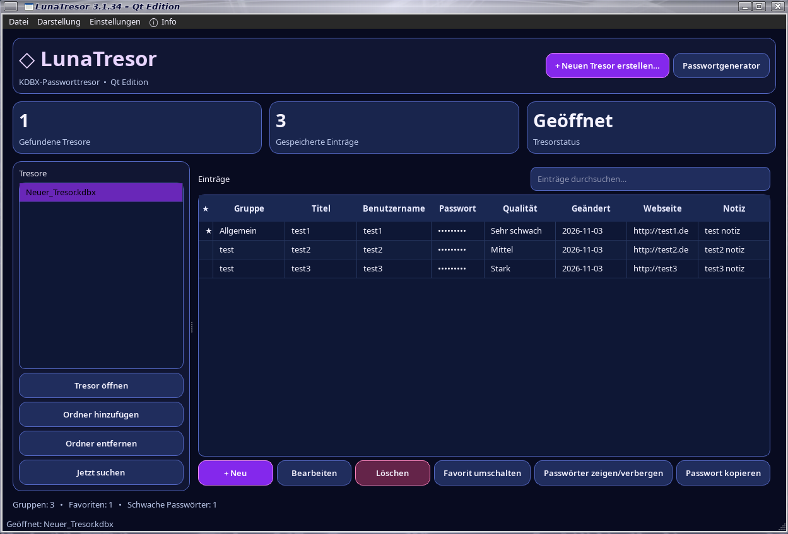

# LunaTresor 3.1.34

**KeePass-kompatible Passwortverwaltung für Linux und Windows**

LunaTresor verwaltet lokale KeePass-KDBX-Tresore mit einer Qt-Oberfläche. Die Anwendung kann unter Linux als Debian-Paket oder direkt aus dem Python-Quellcode gestartet werden. Unter Windows läuft sie direkt mit Python – ohne EXE und ohne Installer.

> **Wichtig:** Linux und Windows verwenden dasselbe KDBX-Dateiformat. Du kannst deine Tresordatei zwischen beiden Systemen übertragen. Bewahre immer eine sichere Sicherungskopie deiner KDBX-Datei auf.



[Github Seite](https://github.com/Angonikro/LunaTresor/)

---

## Inhalt

- [Funktionen](#funktionen)
- [Linux: Debian-Paket-DEB installieren](#linux-debian-paket-deb-installieren)
- [Linux: aus dem Quellcode starten](#linux-aus-dem-quellcode-starten)
- [Windows: ohne EXE starten](#windows-ohne-exe-starten)
- [Einstellungen und Speicherorte](#einstellungen-und-speicherorte)
- [Abhängigkeiten](#abhängigkeiten)
- [Fehlerbehebung](#fehlerbehebung)
- [Sicherheitshinweise](#sicherheitshinweise)

## Funktionen

- KeePass-kompatible KDBX-Tresore öffnen und erstellen
- Gefundene Tresore anzeigen und zusätzliche Suchordner verwalten
- Einträge mit Titel, Benutzername, Passwort, Webseite, Gruppe und Notizen
- Gruppen und Untergruppen verwalten
- Favoriten markieren
- Passwörter ein- und ausblenden sowie in die Zwischenablage kopieren
- Passwortgenerator mit einstellbarer Länge
- Anzeige der Passwortqualität
- PIN-Entsperrung und automatische Sperre bei Inaktivität
- Verschlüsselter LunaTresor-Export und -Import
- Deutsche und englische Oberfläche
- Sofortiger Sprachwechsel ohne Neustart
- Helles und dunkles Design

## Linux: Debian-Paket-DEB installieren

Für Debian, Raspberry Pi OS und kompatible Debian-basierte Systeme.

### Installation per Terminal

1. Lade `lunatresor_3.1.34_all.deb` herunter.
2. Öffne ein Terminal im Download-Ordner.
3. Installiere das Paket mit:

   ```bash
   sudo apt install ./lunatresor_3.1.34_all.deb
   ```

   `apt` installiert dabei, soweit verfügbar, auch die benötigten Paketabhängigkeiten.

4. Starte LunaTresor über das Anwendungsmenü oder mit:

   ```bash
   lunatresor
   ```

### Installation per grafischer Paketverwaltung

Je nach Desktop-Umgebung kannst du die heruntergeladene DEB-Datei doppelt anklicken und mit der angebotenen Paketverwaltung installieren.

### Deinstallation

```bash
sudo apt remove lunatresor
```

Die persönlichen Einstellungen und deine KDBX-Dateien werden dadurch nicht absichtlich gelöscht. Prüfe deine eigenen Speicherorte und Sicherungen vor jeder Deinstallation.

## Linux: aus dem Quellcode starten

Voraussetzungen: Python 3 sowie die Pakete PySide6, pykeepass und cryptography.

Installiere die Abhängigkeiten beispielsweise mit:

```bash
python3 -m pip install -r requirements.txt
```

Falls deine Distribution die Installation mit pip in die System-Python-Umgebung blockiert, verwende die von der Distribution bereitgestellten Python-Pakete oder eine virtuelle Umgebung.

Starte LunaTresor anschließend im Programmordner:

```bash
python3 main.py
```

## Windows: ohne EXE starten

LunaTresor wird unter Windows direkt mit Python ausgeführt. Es wird weder eine EXE noch ein Installer benötigt.

### 1. Python installieren

- Installiere eine aktuelle Python-3-Version von [python.org](https://www.python.org/downloads/windows/).
- Aktiviere während der Installation die Option **Add Python to PATH**.

### 2. ZIP entpacken

Entpacke `LunaTresor_3.1.34_GITHUB.zip`. Danach erhältst du den Ordner:

```text
LunaTresor/
    main.py
    README.md
    requirements.txt
    VERSION
    CHANGELOG.md
    LICENSE
    build_deb.sh
```

### 3. Abhängigkeiten installieren

Öffne PowerShell im Ordner `LunaTresor` und führe aus:

```powershell
py -m pip install -r requirements.txt
```

### 4. LunaTresor starten

Im selben PowerShell-Fenster:

```powershell
py main.py
```

Das Programmfenster von LunaTresor sollte sich öffnen.

### Windows aktualisieren

Entpacke die neue Quellcode-ZIP in einen neuen Ordner und starte sie wie oben beschrieben. Kopiere deine KDBX-Dateien nicht versehentlich über ältere oder neuere Versionen hinweg; die Tresordatei bleibt separat.

## Einstellungen und Speicherorte

| Betriebssystem | Speicherort |
|---|---|
| Linux (Standard) | `~/.config/lunatresor/settings.json` |
| Linux (mit XDG) | `$XDG_CONFIG_HOME/lunatresor/settings.json` |
| Windows | `%APPDATA%\LunaTresor\settings.json` |

Die Einstellungen enthalten unter anderem Sprache, Design, Suchordner und PIN-Daten. Die KDBX-Tresordateien werden an dem Ort gespeichert, den du beim Erstellen oder Öffnen auswählst; sie werden nicht automatisch in den Konfigurationsordner verschoben.

## Abhängigkeiten

Die Python-Quellcodeversion benötigt:

- **PySide6** – grafische Oberfläche
- **pykeepass** – Lesen und Schreiben von KeePass-KDBX-Dateien
- **cryptography** – kryptografische Funktionen für PIN und verschlüsselten Export

Die Abhängigkeiten sind in `requirements.txt` aufgeführt.

## Fehlerbehebung

### `py` wird unter Windows nicht gefunden

Prüfe, ob Python installiert und zum PATH hinzugefügt wurde. Schließe PowerShell und öffne es erneut. Alternativ kann `python` statt `py` funktionieren:

```powershell
python -m pip install -r requirements.txt
python main.py
```

### Modul fehlt (`No module named ...`)

Installiere die Abhängigkeiten erneut im selben Python-Kontext, mit dem du LunaTresor startest:

```powershell
py -m pip install -r requirements.txt
```

Unter Linux:

```bash
python3 -m pip install -r requirements.txt
```

### DEB-Abhängigkeiten fehlen

Aktualisiere die Paketlisten und installiere das lokale Paket mit `apt`:

```bash
sudo apt update
sudo apt install ./lunatresor_3.1.34_all.deb
```

## Sicherheitshinweise

- Schütze deine KDBX-Datei mit einem starken Master-Passwort.
- Erstelle regelmäßig verschlüsselte oder anderweitig sichere Backups deiner Tresordatei.
- Teile weder Master-Passwort noch PIN.
- Die PIN-Funktion ist eine lokale Entsperrfunktion und ersetzt kein starkes Master-Passwort für die KDBX-Datei.
- Prüfe vor dem Austausch von Tresordateien, ob die aktuelle Datei vollständig gespeichert und geschlossen wurde.
- Diese README ist keine unabhängige Sicherheitsprüfung oder Zertifizierung der Anwendung.

---

**Projekt:** LunaTresor  
**Version:** 3.1.34  
**Copyright:** Goldisoft 2026

73 de DO2QG Andreas
